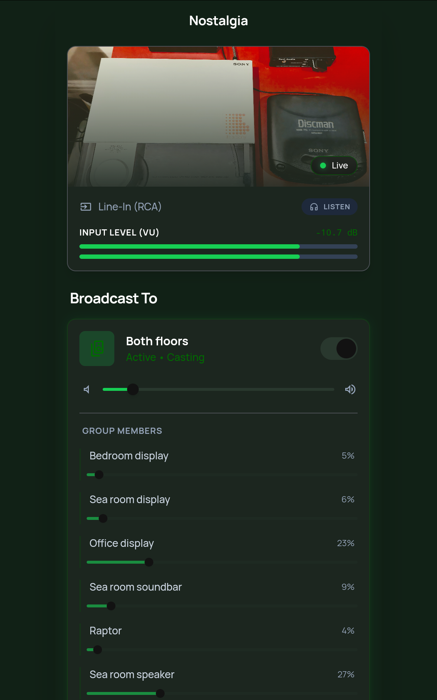

# Nostalgia



A digital companion for a vintage vinyl setup. Captures audio from a USB interface on a Raspberry Pi, visualizes it on a tablet (VU Meter), and streams it to Google Cast devices in the house.

## System Architecture

*   **Hardware:** Raspberry Pi 4 (Server), Nexus 7 Tablet (Client), Behringer UCA222 (ADC).
*   **Backend:** Python (FastAPI, WebSockets, FFmpeg).
*   **Frontend:** React (Vite, Tailwind CSS).
*   **Deployment:** Nginx + Systemd on Raspberry Pi.

## Features

*   **Real-time VU Meter:** Visualizes audio levels on the tablet with low latency.
*   **Multi-Room Streaming:** Broadcasts vinyl audio to Google Cast groups.
*   **Playback Control:** Start/Stop casting and adjust volume from the tablet.
*   **Local Monitoring:** Listen to the stream directly in the browser.

## Getting Started

### Prerequisites

*   Node.js & npm
*   Python 3.11+
*   Raspberry Pi with `nostalgia` hostname configured (or update `deploy.sh`).

### Installation (Local Dev)

1.  **Frontend:**
    ```bash
    cd frontend
    npm install
    npm run dev
    ```

2.  **Backend:**
    ```bash
    cd backend
    pip install -r requirements.txt
    uvicorn main:app --reload
    ```

## Deployment

Use the included script to deploy to the Raspberry Pi:

```bash
./deploy.sh                  # Deploy both Frontend and Backend
./deploy.sh --frontend-only  # Deploy only Frontend
./deploy.sh --backend-only   # Deploy only Backend
```

## Configuration

*   **Nginx:** See `backend/nostalgia.nginx`.
*   **Systemd:** See `backend/nostalgia.service`.
*   **Audio Device:** Configured in `backend/broadcaster.py` and `backend/vu_meter.py` (Default: `plug:dsnoop:1`).

## License
MIT